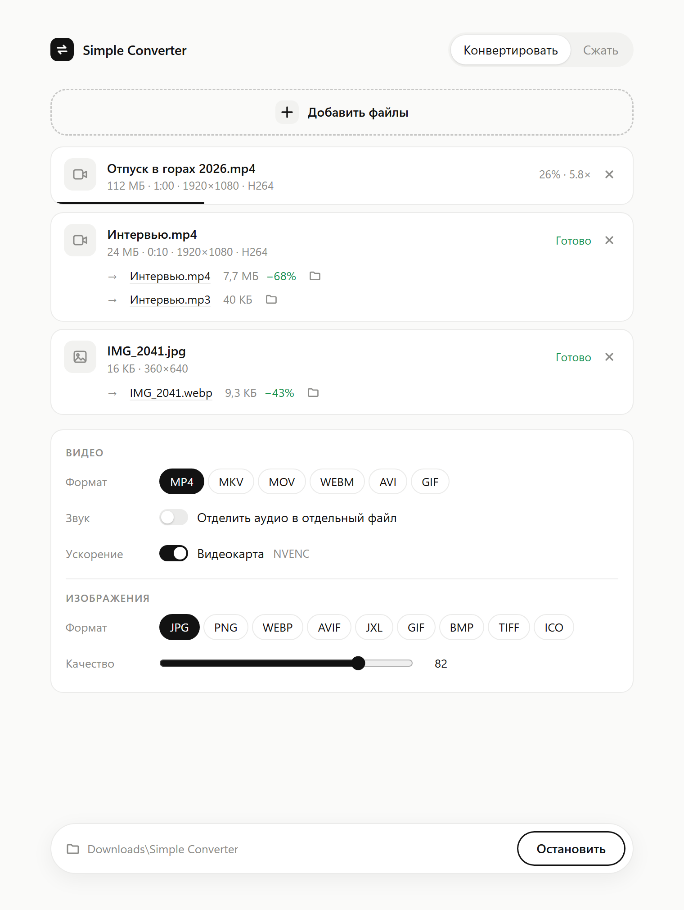

# Simple Converter

Локальный конвертер видео, изображений и аудио с минималистичным веб-интерфейсом.
Работает офлайн, файлы никуда не отправляются.

<p align="center"></p>

## Скачать

**[Последняя версия → Releases](https://github.com/rostislav-kuparo/simple-converter/releases/latest)**

- `SimpleConverter-Setup-x.y.z.exe` — установщик для Windows 10/11 (x64). FFmpeg уже внутри, права
  администратора не нужны. Создаёт ярлыки на рабочем столе и в меню «Пуск», появляется в
  «Параметры → Приложения → Установленные приложения» и удаляется оттуда же.
- `SimpleConverter-x.y.z-portable.exe` — один файл без установки; нужен FFmpeg (см. ниже).

Установщик не подписан сертификатом, поэтому при первом запуске Windows SmartScreen может показать
«Система Windows защитила ваш компьютер»: нажмите «Подробнее» → «Выполнить в любом случае».

## Возможности

- **Конвертация видео**: MP4, MKV, MOV, WEBM, AVI, GIF. Если кодеки подходят новому контейнеру, файл
  перепаковывается без перекодирования: 100 МБ обрабатываются за доли секунды.
- **Сжатие видео**: H.264 / H.265 / AV1, три уровня качества, ограничение разрешения,
  режим «Не больше N МБ» (сам снизит разрешение, если битрейта не хватает).
- **Аппаратное ускорение**: NVIDIA NVENC, Intel Quick Sync, AMD AMF определяются автоматически.
  Если видеокарта не справилась (например, кадр слишком маленький), задача сама повторится на CPU.
- **Изображения**: JPG, PNG, WEBP, AVIF, JPEG XL, GIF, BMP, TIFF, ICO. Учитывается EXIF-поворот,
  прозрачность при переводе в JPG заливается белым. На вход принимаются и HEIC/AVIF/PSD/TGA и т. д.
- **Отделение аудио**: переключатель «Отделить аудио» сохраняет дорожку отдельным файлом
  (MP3, AAC, OPUS, FLAC, WAV или «Как в видео» — без потерь и мгновенно). Видео при этом можно
  оставить без звука, со звуком или не сохранять совсем.
- **Аудиофайлы**: MP3, AAC, OPUS, OGG, FLAC, WAV.
- Пакетная обработка, прогресс и скорость в реальном времени, отмена, вставка картинок через Ctrl+V,
  светлая и тёмная тема.

Результаты сохраняются в `Загрузки\Simple Converter`. Клик по имени файла открывает его,
иконка папки показывает файл в проводнике.

## Портативная версия и FFmpeg

Установщик уже содержит FFmpeg. Портативному `.exe` он нужен отдельно. Если его нет:

```bash
winget install Gyan.FFmpeg
```

Программа ищет `ffmpeg.exe` и `ffprobe.exe` рядом с собой (в той же папке, в `ffmpeg`, `ffmpeg\bin`
или `bin`), затем в `PATH`. Для переносной версии достаточно положить их рядом с exe.

## Как пользоваться

Интерфейс открывается отдельным окном (Chrome или Edge в режиме приложения). Когда окно закрыто
и задач нет, программа завершается сама. Повторный запуск при открытой программе просто показывает её окно.

Параметры командной строки:

| Флаг | Что делает |
|---|---|
| `--browser` | открыть в обычной вкладке браузера вместо отдельного окна |
| `--out <папка>` | другая папка для результатов |
| `--server` | только сервер на `http://127.0.0.1:47380`, без окна и автозавершения |

## Сборка

Нужны Rust (MSVC) и Windows SDK. Только exe:

```bash
cargo build --release
```

Exe + установщик в папку `dist` (нужен [Inno Setup 6](https://jrsoftware.org/isinfo.php): `winget install JRSoftware.InnoSetup`):

```bash
powershell -ExecutionPolicy Bypass -File installer\build.ps1 -FFmpegBin C:\ffmpeg\bin
```

Иконка рисуется скриптом `assets/make_icon.py` (Python без зависимостей).

## Лицензия

Код Simple Converter — MIT. Установщик включает FFmpeg (GPL v3) отдельными программами
`ffmpeg.exe` и `ffprobe.exe`; лицензия и ссылка на исходники лежат рядом с ними в папке `ffmpeg`.

## Почему Rust

Скорость конвертации определяет FFmpeg: оптимизированный C/ассемблер плюс аппаратные кодеры видеокарты.
Язык обёртки на неё почти не влияет. Rust здесь даёт мгновенный запуск, маленький самодостаточный `.exe`
без рантайма, низкое потребление памяти и потоковую загрузку файлов любого размера без буферизации в ОЗУ.

## Как устроено

```
ui/index.html     интерфейс: один файл без зависимостей, вшит в exe
src/main.rs       HTTP-сервер (axum), загрузка, события (SSE), открытие окна, автозавершение
src/media.rs      поиск FFmpeg, проверка GPU-кодеров, ffprobe
src/plan.rs       выбор кодеков и сборка аргументов FFmpeg
src/job.rs        очередь, запуск FFmpeg, прогресс, отмена, откат с GPU на CPU
src/state.rs      общее состояние и имена выходных файлов
build.rs          иконка и сведения о версии внутри exe
installer/        сценарий Inno Setup и скрипт сборки установщика
```

Видео кодируются максимум по два одновременно (каждое и так занимает все ядра или GPU),
картинки и аудио — параллельно на половине ядер.
